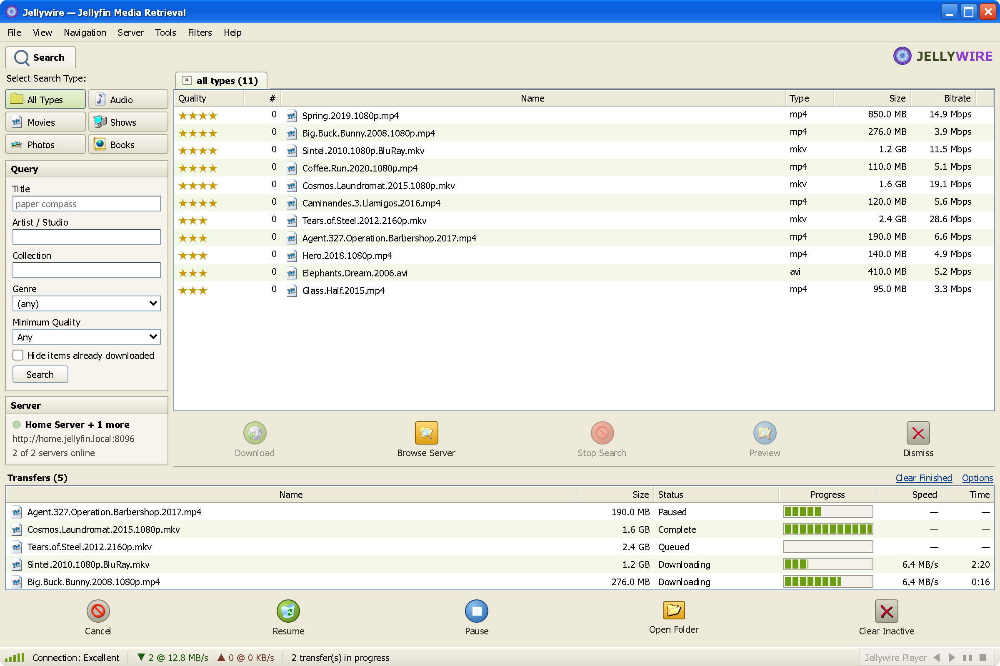
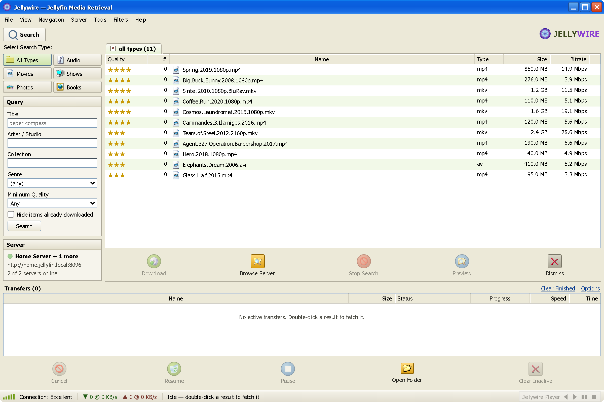
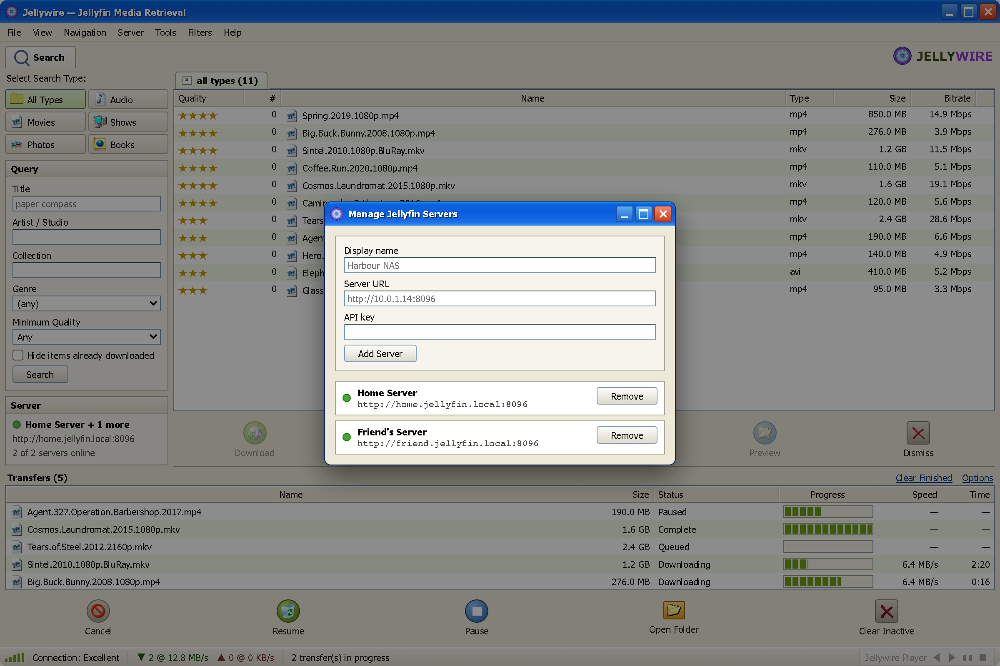

<div align="center">


# Jellywire

**A LimeWire-style desktop client for searching and downloading media across multiple Jellyfin servers.**

Built with [Tauri](https://tauri.app), React and Vite.

</div>

<p align="center">
  
</p>

## Why Jellywire?

Jellyfin is great for streaming from one server. Jellywire is for when you have access to *several* (your own, a friend's, a family member's) and just want to find a file and get it onto your disk. It wraps the Jellyfin API in a nostalgic early-2000s file-sharing UI.

## Features

- **Multi-server search** – connect any number of Jellyfin servers and search them all at once; results are merged into a single table.
- **Show and album expansion** – searching for a series or album returns every individual episode or track, not just the top-level entry.
- **Filter by type** – All Types, Audio, Movies and Shows, plus genre, minimum quality and "hide items already downloaded" filters.
- **Sortable results** – quality rating, file name, container, size and bitrate at a glance.
- **Download queue** – transfers with progress bars, speed and time remaining, plus pause, resume, cancel and clear.
- **Streaming preview** – preview an item before committing to the download.
- **Choose where files go** – configure your download folder from the Tools menu.
- **Native and lightweight** – a Tauri app, so no bundled Chromium.

## Screenshots

| Search across servers | Manage servers |
| --- | --- |
|  |  |

## Getting started

### Prerequisites

- [Node.js](https://nodejs.org) (a current LTS release)
- [Rust](https://www.rust-lang.org/tools/install) and the [Tauri platform prerequisites](https://tauri.app/start/prerequisites/)
- One or more Jellyfin servers and an API key for each

### Run from source

```bash
git clone https://github.com/Nikorag/Jellywire.git
cd Jellywire
npm install
npm run tauri dev
```

To produce an installable build for your platform:

```bash
npm run tauri build
```

### Connecting a server

1. In Jellyfin, open **Dashboard → API Keys** and create a key for Jellywire.
2. In Jellywire, open **Server** in the menu bar.
3. Enter a display name, the server URL (e.g. `http://192.168.1.10:8096`) and the API key, then click **Add Server**.
4. Repeat for any other servers, then search.

Servers are saved locally and reconnect on launch. API keys are stored in the app's local storage on your machine; only add servers you trust with that key.

## Development

| Command | What it does |
| --- | --- |
| `npm run tauri dev` | Run the desktop app with hot reload |
| `npm run dev` | Run the UI alone in a browser at `localhost:1420` |
| `npm run storybook` | Browse the component library |
| `npm test` | Run unit tests (Vitest) |
| `npm run test:e2e` | Run Playwright end-to-end tests |
| `npm run screenshots` | Regenerate the README screenshots using a mocked Jellyfin API |

The end-to-end test runs against a real server. Put `JELLYFIN_URL` and `JELLYFIN_API_KEY` in `.env.local`, or it skips itself.

### Project layout

- `src/components/{atoms,molecules,organisms,templates,pages}` – atomic design component library, each with Storybook stories
- `src/store` – Zustand stores for servers, settings and the download queue
- `src/lib/jellyfinClient.ts` – Jellyfin REST client and multi-server search aggregation
- `src/lib/downloadEngine.ts`, `src/lib/downloadManager.ts` – stream downloads to disk via the Tauri HTTP and filesystem plugins
- `src-tauri` – the Tauri (Rust) shell
- `scripts/screenshots.ts` – generates `docs/screenshots`

Recommended editor setup: [VS Code](https://code.visualstudio.com/) with the [Tauri](https://marketplace.visualstudio.com/items?itemName=tauri-apps.tauri-vscode) and [rust-analyzer](https://marketplace.visualstudio.com/items?itemName=rust-lang.rust-analyzer) extensions.

## Contributing

Issues and pull requests are welcome. For anything sizeable, please open an issue first to discuss it. Before submitting, run `npm test` and `npx tsc --noEmit`.

## Disclaimer

Jellywire is an independent project and is not affiliated with or endorsed by Jellyfin or LimeWire. Only download media you have the right to access.
